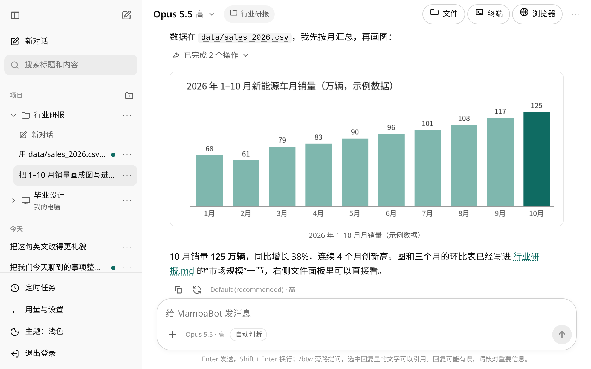
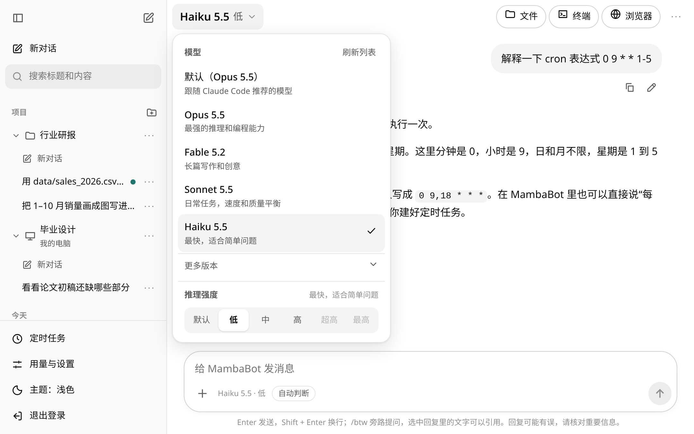
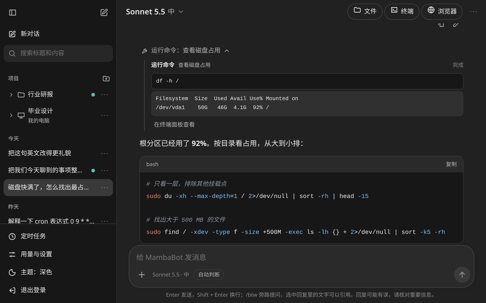
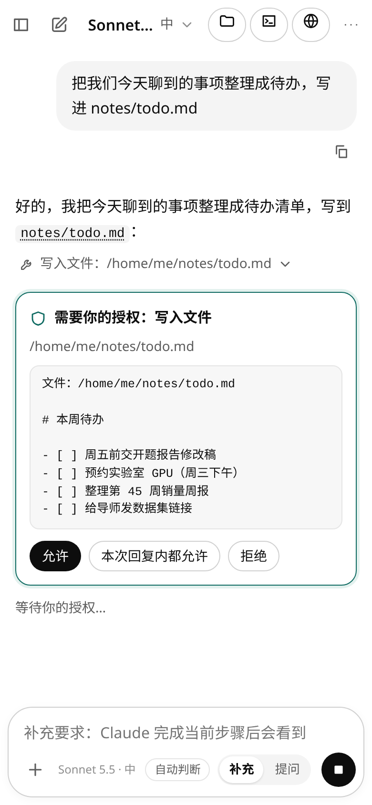
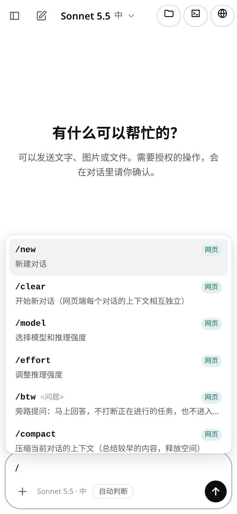
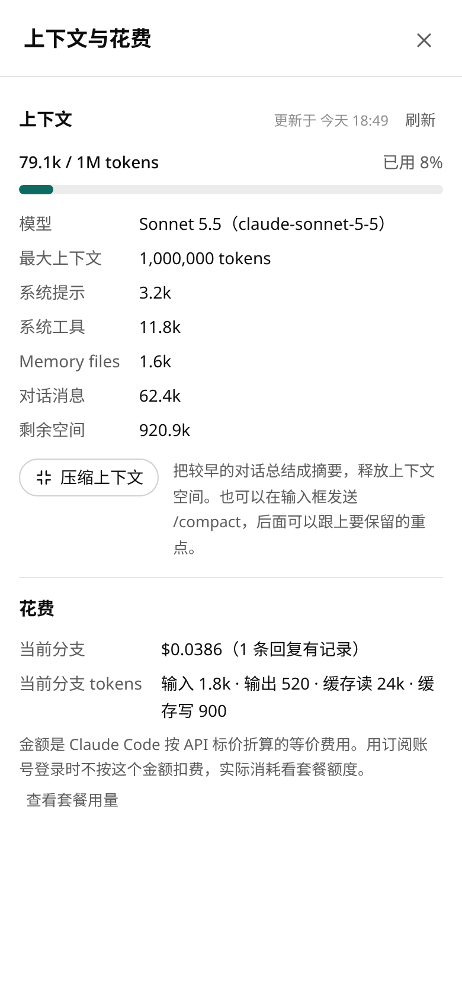
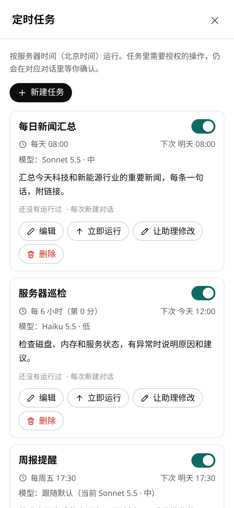
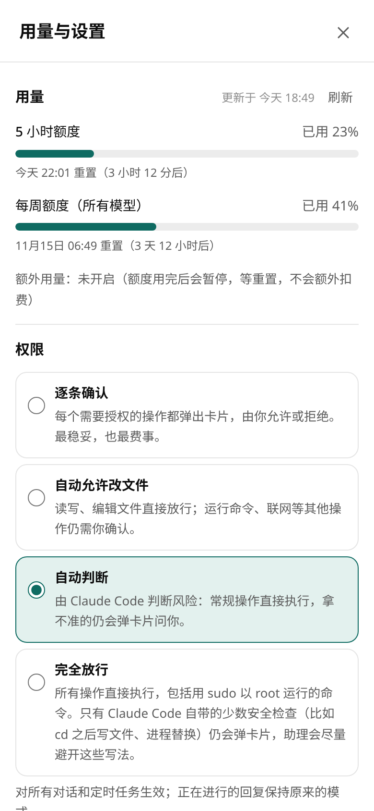

# MambaBot

**开源、自托管的 24 小时常驻 AI Agent：Grok Bot、ChatGPT dots、Meta Muse 这一类产品的开源版。**

今年几家大厂都在做常驻 Agent：给 AI 一台自己的云电脑和浏览器，它一直在线，你在手机上派活，它在后台跑，
碰到关键操作再来问你。这些产品要么要贵的订阅档，要么限地区，数据和电脑都在厂商的云里。

MambaBot 把同样的体验放到**你自己的服务器**上：一台云主机加上你已经登录的
[Claude Code](https://docs.claude.com/en/docs/claude-code)，就是一个完全由你掌控的常驻 Agent。
手机或电脑打开浏览器就能派活。它在服务器上执行命令、读写文件、浏览网页、定时干活，
每一步需要授权的操作都会先在网页上问你。配合 Tailscale / SSH，还能操作你家里和公司的电脑。

<p align="center">
  
</p>

> 截图都是真实运行的界面，用示例数据截取。上图中，Claude 在服务器上用 headless Chrome 截了一张网页，
> 再用 `show_file` 工具把图片直接显示在回复里。

- **零依赖**：一个 Node.js 进程，没有 npm 依赖，也没有构建步骤。
- **用的就是你的 Claude Code**：每条回复启动一次官方原版的 `claude -p`，订阅登录和 API Key 都可以用，权限规则和 CLI 完全一致。MambaBot 不经手你的 Claude 登录凭据（见[账号与 Anthropic 条款](#账号与-anthropic-条款)）。
- **随时随地**：适配手机屏幕，可以添加到主屏幕；回复完成或需要授权时可以发通知提醒你。
- **一切看得见**：项目文件、Claude 跑过的每条命令和输出、它正在用的浏览器，都在右侧面板里实时可见，你也可以自己动手。

| | ChatGPT dots | Grok Bot | Meta Muse | **MambaBot** |
|---|---|---|---|---|
| 形态 | 常驻 Agent，自带云电脑和 Chrome | 一组“AI 同事”，共享云电脑 | 个人 Agent，专属安全虚拟机 | **你自己云主机上常驻的 Claude Code** |
| 定时 / 例行任务 | 主动做只读调研 | 教会一次，存成 routine 自动跑 | 未公开 | **cron 定时任务，每个任务单独选模型** |
| 浏览器 | 云电脑里的 Chrome，可以打开看 | 能登录没有 API 的网站 | 连接器 | **实时浏览器面板，登录、验证码交还给你** |
| 安全把关 | 代码级护栏和自动审查 | — | Sentinel 审批对外操作 | **每个工具调用弹授权卡片，四种权限模式** |
| 数据在哪 | OpenAI 云 | xAI 云 | Meta 虚拟机 | **你自己的服务器** |
| 开源可改 | 否 | 否 | 否 | **是（GPL-3.0）** |

<sub>竞品信息来自公开报道，以官方为准。MambaBot 与这些公司和产品没有任何关联。</sub>

[English summary](#english) · [架构说明](docs/ARCHITECTURE.md)

---

## 功能一览

### 对话：像聊天一样用 Claude Code

- **模型与推理强度**：可选的模型直接来自 CLI 的 `initialize`（Opus、Sonnet、Haiku……），每个对话可以单独选模型和推理强度。如果运行时实际用的模型和你选的不一样，页面会明确提示。
- **分支**：编辑任何一条消息、重新生成任何一条回复，都会从当时的上下文分叉成新分支（`‹ 1/2 ›`），旧分支随时可以切回去。
- **附件**：图片和文件（≤ 20 MB）可以直接拖进对话，图片会以图片形式发给 Claude。
- **Claude 也能给你看东西**：截图、生成的图表、导出的文件，Claude 用 `show_file` 工具直接展示在回复里。图片点开可以全屏看，其他文件可以直接下载。
- Markdown、表格、代码块一键复制，深色模式，全文搜索，导出 Markdown，只读分享链接。

<p align="center">
  
  
</p>

### 项目和文件面板

- **项目**：侧边栏可以新建项目。每个项目对应服务器上的一个目录：默认新建 `<工作目录>/projects/<项目名>`，也可以指定已有目录。项目里的对话都以这个目录为工作目录运行 `claude -p`，所以共用其中的文件、项目级 `CLAUDE.md` 和 Claude Code 的记忆，不用每次重新交代背景。不用项目时一切照旧。
- **文件面板**：右侧的“文件”面板（和浏览器面板切换）显示当前项目的目录树。Markdown 渲染成排版后的页面（可切换源码），代码和文本带行号，图片直接显示，其他文件可以下载。Claude 改完文件后面板自动刷新；回复里提到的文件路径可以点击打开。手机上全屏显示。
- **终端面板**：右侧的“终端”里可以自己在项目目录下运行命令，输出实时显示，`cd` 会保留到下一条命令，命令需要输入时直接打字回车，随时可以停止（Ctrl+C）。Claude 在当前对话里运行过的每条命令也列在这里（标着“Claude”），点开能看完整命令和输出；回复里的“运行命令”也能一键跳过去。这里不是完整的终端模拟器（不能跑 vim、top 这类全屏程序），颜色和分页器都关掉了。
- 文件面板只读，不在网页里编辑。只能访问项目目录内的文件，符号链接也不能跳出目录；`.env`、私钥、`.ssh`、`.git` 等不显示，也不能作为项目目录选中服务配置和数据目录。

### 安全：每一步都在你眼皮底下

- **授权卡片**：所有需要授权的工具调用（运行命令、写文件、联网……）都会变成一张卡片，上面是完整的命令或文件内容，由你允许或拒绝。服务器从不替你点"允许"。
- **四种权限模式**：逐条确认 / 自动允许改文件 / 自动判断 / 完全放行，随时可以切换。
- **登录**：随机生成的登录密钥，只保存 scrypt 哈希。Cookie 设了 `HttpOnly; SameSite=Strict; Secure`，并且校验 Origin 和 Host（防 DNS rebinding）。登录有限速，CSP 很严格，模型输出只当文本渲染、不当 HTML。

<p align="center">
  
  
  
  
</p>

### 斜杠指令和上下文管理

- 输入 `/` 会列出 CLI 自带的指令和网页专属指令。
- `/compact [要保留的重点]`：调用 Claude Code 自己的压缩功能，把较早的内容总结成摘要，压缩前后的 token 数会显示在对话里。
- `/status`：显示当前分支占用了多少上下文、模型最大上下文是多少、各部分各占多少（数据来自 CLI 的 `get_context_usage`，读取时不调用模型），还有本对话的花费（和终端 `/cost` 同源）。

### 定时任务

- 用 5 段 cron 表达式定时让 Claude 干活，比如每天早上汇总新闻、每 6 小时巡检一次服务器。可以写进同一个对话，也可以每次新建对话。
- 每个任务可以单独选模型和推理强度。Claude 自己也能通过 MCP 工具帮你创建和修改任务，每次改动都要你授权。

### 用量和设置



- 5 小时额度和每周额度的用量、重置时间直接读自 Claude Code（和终端 `/usage` 相同），读取时不调用模型。
- **多个 Claude 账号**：同一台服务器上登录了你自己的几个 Claude 账号时，可以在这里切换，之后的回复和定时任务都用新账号，用量也显示新账号的。几个账号共用对话记录，切换后旧对话照常接着聊。
- 权限模式、同时进行的回复数（1–6）、系统通知都在这里设置。
- 可选的**实时浏览器面板**：服务器上运行一个真实的 [BrowserOS](https://browseros.com)，Claude 操作浏览器时你在网页右侧实时看着。遇到登录、扫码、验证码，Claude 会把控制权交给你，你操作完再交还给它。

<br clear="right">

---

## 快速开始

### 需要准备

- 一台 Linux 服务器（每条进行中的回复大约占 400 MB 内存，同时回复的数量可以在设置里调）
- Node.js ≥ 22
- 已安装并登录的 Claude Code CLI（`claude` 能正常对话即可，订阅登录或 `ANTHROPIC_API_KEY` 都行）。订阅登录请在服务器上用 `claude` 自己的 `/login` 完成，MambaBot 没有、也不会提供 Claude 账号登录入口
- 想从外网访问的话，还需要一个域名，并配置好 nginx + HTTPS

### 运行

```sh
git clone https://github.com/guangxiangdebizi/mambabot-oss.git
cd mambabot-oss
node --test test/*.test.js        # 可选：跑测试（用假 CLI，不调用模型）
node src/server.js                # 默认监听 127.0.0.1:3400
```

第一次启动时会生成登录密钥，保存在 `~/.config/assistant-web/initial-login-secret`（权限 600）。
打开 `http://127.0.0.1:3400`，粘贴这个密钥就能登录。需要换密钥时运行 `node scripts/reset-login.mjs`，然后重启服务。

### 长期运行和对外访问

1. 复制 `deploy/site.env.example` 到 `~/.config/assistant-web/site.env`（`chmod 600`），填写你的域名等设置。
2. 用 tmux 或 systemd 运行 `scripts/serve.sh`：它会用一套干净的环境启动服务，崩溃后自动重启。
   ```sh
   tmux new-session -d -s assistant-web -c ~/mambabot-oss scripts/serve.sh
   ```
3. 参照 `deploy/nginx.example.conf` 配置 nginx 和 HTTPS 证书。流式输出、实时浏览器面板和上传各有专门的 location，直接照抄即可。
4. 以后更新代码：`bash scripts/deploy.sh [commit]`。它会先跑测试和备份，切换后做健康检查，检查不通过会自动回滚。

### 配置

所有设置都是环境变量，`serve.sh` 会从 `site.env` 读取。

| 变量 | 默认值 | 说明 |
|---|---|---|
| `AW_PORT` / `AW_HOST` | `3400` / `127.0.0.1` | 监听地址，建议只监听本机，由 nginx 对外 |
| `AW_ALLOWED_HOSTS` | — | 对外的域名（逗号分隔），用于 Host 校验 |
| `AW_CLAUDE_ACCOUNTS` | — | 你自己在这台机器上的多个 Claude 账号，可在「用量与设置 › Claude 账号」里切换，格式 `名称\|配置目录`，逗号分隔，例如 `"主账号\|~/.claude,第二个\|~/.claude-2"`（见下文） |
| `AW_ACCOUNT_LINKS` | — | 你的其他 MambaBot 站点，显示在「设置 › 切换站点」里，格式 `名称\|https://域名`，逗号分隔（写进 site.env 时加引号） |
| `AW_TRUST_PROXY` / `AW_COOKIE_SECURE` | `0` | 放在 nginx 后面时都设成 `1` |
| `AW_CLAUDE_CWD` | `~/assistant-home` | Claude 的工作目录，网页会话和你在终端里用的会话互不干扰 |
| `AW_DATA_DIR` / `AW_CONFIG_DIR` | `~/.local/share/assistant-web` / `~/.config/assistant-web` | 对话数据 / 登录凭据 |
| `AW_BROWSER_BIN` / `AW_BROWSER_PROFILE` | — | 开启实时浏览器面板，需要 BrowserOS、Xvfb、x11vnc、noVNC，以及 `sudo -n iptables`（把 BrowserOS 的端口限制在本机） |
| `TZ` | `serve.sh` 中为 `UTC` | 定时任务按服务器本地时间计算 |

**多个 Claude 账号**：每个账号用一个单独的 Claude Code 配置目录登录，再让它和默认账号共用对话记录（会话按 id 续接，记忆也在这里）和 skills：

```sh
CLAUDE_CONFIG_DIR=~/.claude-2 claude            # 在交互界面里 /login 登录第二个账号
ln -s ~/.claude/projects ~/.claude-2/projects  # 若已存在，先把里面的内容移到 ~/.claude/projects
ln -s ~/.claude/skills ~/.claude-2/skills
```

然后在 `site.env` 里写上 `AW_CLAUDE_ACCOUNTS="主账号|~/.claude,第二个|~/.claude-2"` 并重启服务。没有共用对话记录的账号会在设置里标出来。只放你本人的账号，见[账号与 Anthropic 条款](#账号与-anthropic-条款)。

**写给 Claude 的本机说明**：在 `~/.config/assistant-web/handoff.md` 里写这台机器的情况，例如"这是一台 2 核服务器""可以用 `sudo -n`""SSH 别名 xxx 指向哪台机器"，
每次回复都会附在 Claude 的系统提示后面。这个文件只放在你的服务器上，不进仓库。

---

## 安全须知

MambaBot 让一个网页登录直接拥有服务器上那个用户的全部能力。请务必：

- **保管好登录密钥**。拿到密钥的人能做的，和你 SSH 登录这台机器能做的一样多（终端面板就是一个直接的命令行）。
- 对外访问一定要走 HTTPS（参考 `deploy/nginx.example.conf`）。
- "完全放行"模式下，Claude 的工具调用不再逐条确认。如果这个用户还有免密 sudo，就等于网页登录直接拥有 root。
- Claude 浏览网页时读到的内容可能含有提示注入。重要操作建议保持"逐条确认"或"自动判断"模式。

详细的安全模型见 [docs/ARCHITECTURE.md](docs/ARCHITECTURE.md#security-model)。

---

## 账号与 Anthropic 条款

MambaBot 只是官方 Claude Code 的一个网页前端，用的是你自己的账号，所以 Anthropic 的条款照样适用于你。违反条款可能导致账号被暂停或封禁，而且申诉很难成功。

**MambaBot 自己的做法**

- 只调用 Anthropic 发布的原版 `claude` CLI，不修改它，也不替换它的登录方式。
- 「多个 Claude 账号」只是切换 `CLAUDE_CONFIG_DIR`，让 CLI 用另一个已经登录好的配置目录；每个账号都要你自己在服务器上用 `/login` 登录。
- 不读取、不保存、不转发你的 Claude 登录凭据：登录完全由 `claude` 自己的 `/login` 流程完成；网页登录密钥只用来进 MambaBot，和 Claude 账号无关；`~/.claude/.credentials.json` 在文件面板和 `show_file` 里都被禁止访问。

**你在部署和使用时需要注意**

- **一个部署只给你自己用**。不要把 MambaBot 的登录密钥给别人，也不要用你的订阅给别人提供服务、代跑或收费。Consumer Terms 禁止共享账号；Claude Code 的条款也不允许用 Pro / Max 的订阅凭据替别人转发请求。想给几个人用，就让每个人各自部署、各自登录自己的账号；要做成面向他人的服务，请改用 Claude Console 的 API Key，并遵守 Commercial Terms。
- **订阅额度按普通的个人使用设计**。定时任务按需设置，不要让 Claude 24 小时满负荷空转。
- **一个账号被封后，不要换另一个账号继续用**。使用政策明确禁止用其他账号绕过封禁。「多个 Claude 账号」只用来放你本人的账号，不要放别人的。
- **地区**：Anthropic 只在[支持的国家和地区](https://www.anthropic.com/supported-countries)提供服务。服务器放在支持的地区，并不等于你本人所在的地区也受支持，请自行确认。
- **内容**：遵守 [Usage Policy](https://www.anthropic.com/legal/aup)，不要尝试越狱或绕过模型的安全限制。

以上只是提醒，不构成法律意见，一切以 Anthropic 的最新条款为准：[Consumer Terms](https://www.anthropic.com/legal/consumer-terms)、[Usage Policy](https://www.anthropic.com/legal/aup)、[Claude Code Legal and compliance](https://code.claude.com/docs/en/legal-and-compliance)。

---

## English

**MambaBot** is an open-source, self-hosted, always-on AI agent: the same idea as Grok Bot, ChatGPT dots and Meta Muse,
on your own server and with your own Claude Code login, built for phones as much as desktops. It is one dependency-free
Node.js process that starts `claude -p` (stream-json) for each reply. It includes:

- model and effort picker, branching chats (edit/regenerate fork the CLI session), attachments, and Claude showing you images and files inline
- approval cards for every permission prompt, with four permission modes
- a terminal panel: run your own commands in the project directory, and see every command Claude ran in the chat with its output
- projects: chats grouped by a server directory that is their working directory (shared files, `CLAUDE.md` and memory), with a read-only file panel (Markdown rendered, code with line numbers, images, downloads; clickable paths in replies)
- `/compact`, `/status` (context window and spend), scheduled tasks via cron, plan usage, and an optional live BrowserOS panel with human hand-off for logins and captchas
- switching between several of your own Claude accounts on the host (`AW_CLAUDE_ACCOUNTS`, one Claude Code config directory each, sharing `~/.claude/projects`)

Quick start: `node src/server.js`, then log in with the secret in `~/.config/assistant-web/initial-login-secret`.
For long-running and public deployments, see `scripts/serve.sh`, `deploy/site.env.example` and `deploy/nginx.example.conf`;
for internals, see [docs/ARCHITECTURE.md](docs/ARCHITECTURE.md). The UI is in Simplified Chinese.

**Accounts and Anthropic's terms.** MambaBot runs the unmodified `claude` CLI and never reads, stores or relays your
Claude credentials; sign in with `claude`'s own `/login` on the server. Use each deployment for yourself only: do not
share the login secret or serve other people through your Pro/Max subscription. Anyone else should deploy their own copy
with their own account, and products for other users should use a Console API key. Anthropic's
[Consumer Terms](https://www.anthropic.com/legal/consumer-terms), [Usage Policy](https://www.anthropic.com/legal/aup),
[supported regions](https://www.anthropic.com/supported-countries) and
[Claude Code legal terms](https://code.claude.com/docs/en/legal-and-compliance) apply; violations can get your account suspended.

## License

[GPL-3.0](LICENSE). MambaBot is an independent project. It is not affiliated with or endorsed by Anthropic.
"Claude" and "Claude Code" are trademarks of Anthropic.
