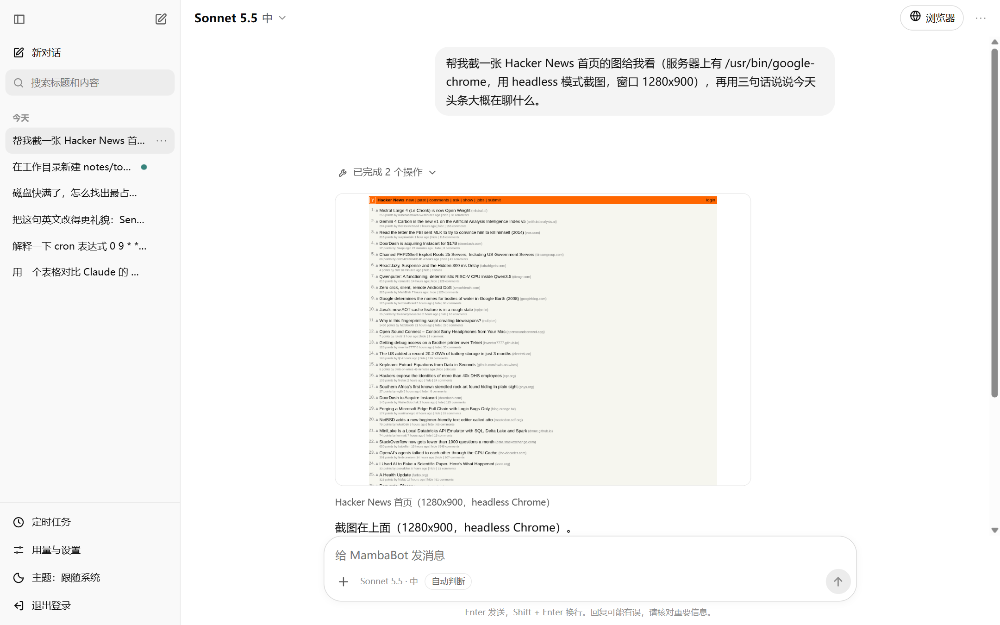
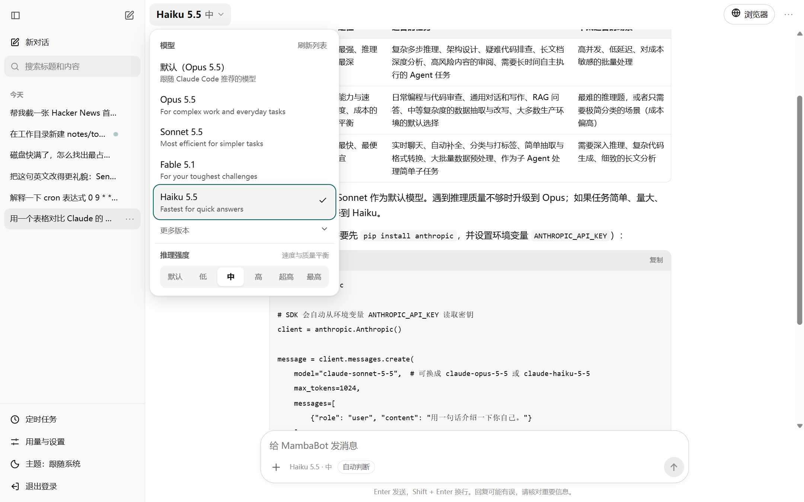
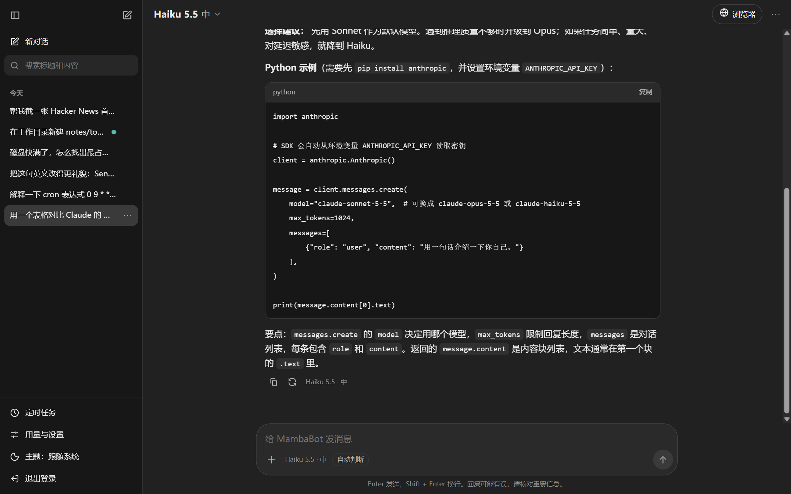
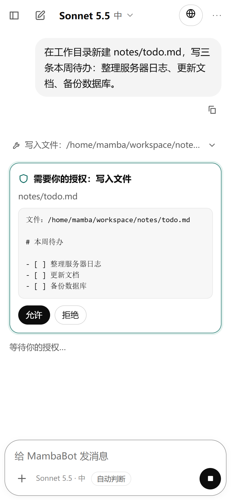
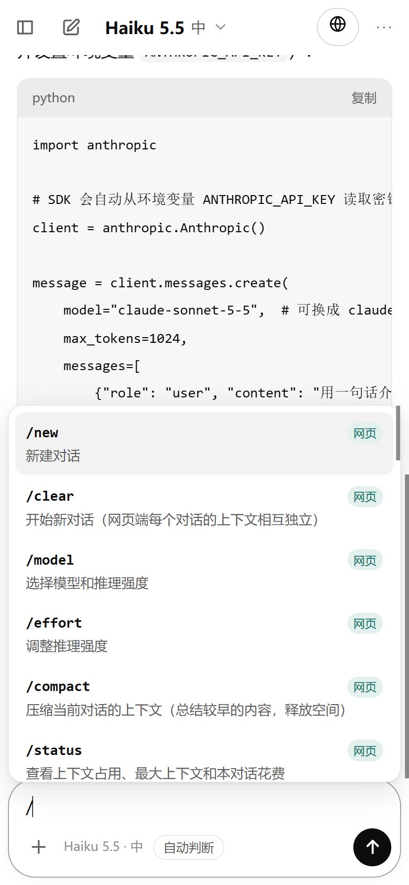
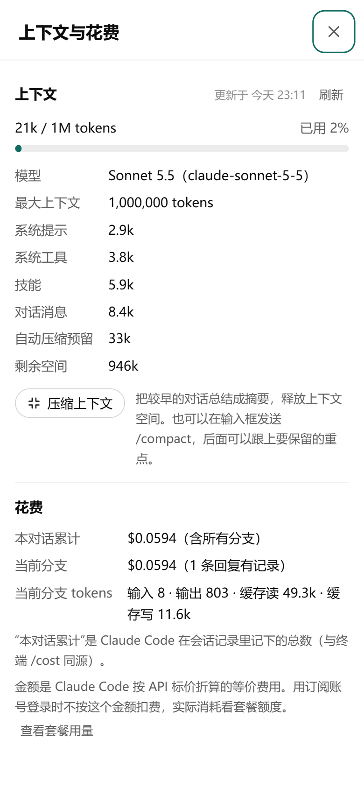
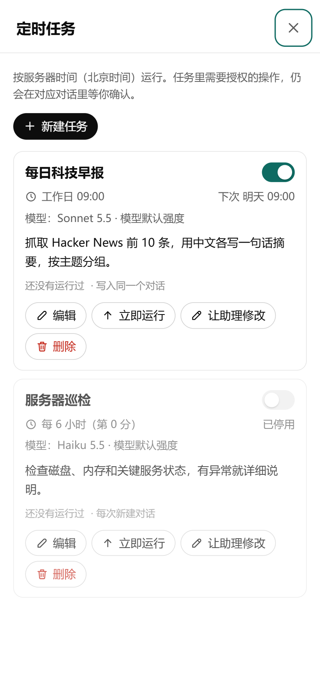
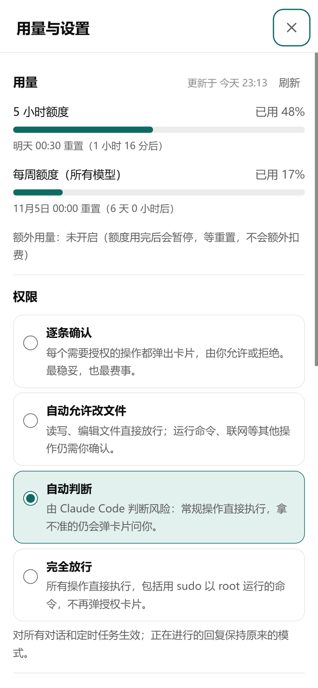

# MambaBot

**在手机上使用你自己服务器上的 Claude Code。**

MambaBot 是一个自托管、单用户的网页界面，用来使用你服务器上已经登录的 [Claude Code](https://docs.claude.com/en/docs/claude-code)。
手机或电脑打开浏览器就能和 Claude 对话。它可以在服务器上执行命令、读写文件、浏览网页、定时干活，
做每一步需要授权的操作之前，都会先在网页上问你。

<p align="center">
  
</p>

> 截图都是真实运行的界面，用示例数据截取。上图中，Claude 在服务器上用 headless Chrome 截了一张网页，
> 再用 `show_file` 工具把图片直接显示在回复里。

- **零依赖**：一个 Node.js 进程，没有 npm 依赖，也没有构建步骤。
- **用的就是你的 Claude Code**：每条回复启动一次 `claude -p`，订阅登录和 API Key 都可以用，权限规则和 CLI 完全一致。
- **随时随地**：适配手机屏幕，可以添加到主屏幕；回复完成或需要授权时可以发通知提醒你。

[English summary](#english) · [架构说明](docs/ARCHITECTURE.md)

---

## 功能一览

### 对话：像聊天一样用 Claude Code

- **模型与推理强度**：可选的模型直接来自 CLI 的 `initialize`（Opus、Sonnet、Haiku……），每个对话可以单独选模型和推理强度。如果运行时实际用的模型和你选的不一样，页面会明确提示。
- **分支**：编辑任何一条消息、重新生成任何一条回复，都会从当时的上下文分叉成新分支（`‹ 1/2 ›`），旧分支随时可以切回去。
- **附件**：图片和文件（≤ 20 MB）可以直接拖进对话，图片会以图片形式发给 Claude。
- **Claude 也能给你看东西**：截图、生成的图表、导出的文件，Claude 用 `show_file` 工具直接展示在回复里。图片点开可以全屏看，其他文件可以直接下载。
- Markdown、表格、代码块一键复制，深色模式，全文搜索，导出 Markdown，只读分享链接。

<p align="center">
  
  
</p>

### 安全：每一步都在你眼皮底下

- **授权卡片**：所有需要授权的工具调用（运行命令、写文件、联网……）都会变成一张卡片，上面是完整的命令或文件内容，由你允许或拒绝。服务器从不替你点"允许"。
- **四种权限模式**：逐条确认 / 自动允许改文件 / 自动判断 / 完全放行，随时可以切换。
- **登录**：随机生成的登录密钥，只保存 scrypt 哈希。Cookie 设了 `HttpOnly; SameSite=Strict; Secure`，并且校验 Origin 和 Host（防 DNS rebinding）。登录有限速，CSP 很严格，模型输出只当文本渲染、不当 HTML。

<p align="center">
  
  
  
  
</p>

### 斜杠指令和上下文管理

- 输入 `/` 会列出 CLI 自带的指令和网页专属指令。
- `/compact [要保留的重点]`：调用 Claude Code 自己的压缩功能，把较早的内容总结成摘要，压缩前后的 token 数会显示在对话里。
- `/status`：显示当前分支占用了多少上下文、模型最大上下文是多少、各部分各占多少（数据来自 CLI 的 `get_context_usage`，读取时不调用模型），还有本对话的花费（和终端 `/cost` 同源）。

### 定时任务

- 用 5 段 cron 表达式定时让 Claude 干活，比如每天早上汇总新闻、每 6 小时巡检一次服务器。可以写进同一个对话，也可以每次新建对话。
- 每个任务可以单独选模型和推理强度。Claude 自己也能通过 MCP 工具帮你创建和修改任务，每次改动都要你授权。

### 用量和设置



- 5 小时额度和每周额度的用量、重置时间直接读自 Claude Code（和终端 `/usage` 相同），读取时不调用模型。
- 权限模式、同时进行的回复数（1–6）、系统通知都在这里设置。
- 可选的**实时浏览器面板**：服务器上运行一个真实的 [BrowserOS](https://browseros.com)，Claude 操作浏览器时你在网页右侧实时看着。遇到登录、扫码、验证码，Claude 会把控制权交给你，你操作完再交还给它。

<br clear="right">

---

## 快速开始

### 需要准备

- 一台 Linux 服务器（每条进行中的回复大约占 400 MB 内存，同时回复的数量可以在设置里调）
- Node.js ≥ 22
- 已安装并登录的 Claude Code CLI（`claude` 能正常对话即可，订阅登录或 `ANTHROPIC_API_KEY` 都行）
- 想从外网访问的话，还需要一个域名，并配置好 nginx + HTTPS

### 运行

```sh
git clone https://github.com/guangxiangdebizi/mambabot-oss.git
cd mambabot-oss
node --test test/*.test.js        # 可选：跑测试（用假 CLI，不调用模型）
node src/server.js                # 默认监听 127.0.0.1:3400
```

第一次启动时会生成登录密钥，保存在 `~/.config/assistant-web/initial-login-secret`（权限 600）。
打开 `http://127.0.0.1:3400`，粘贴这个密钥就能登录。需要换密钥时运行 `node scripts/reset-login.mjs`，然后重启服务。

### 长期运行和对外访问

1. 复制 `deploy/site.env.example` 到 `~/.config/assistant-web/site.env`（`chmod 600`），填写你的域名等设置。
2. 用 tmux 或 systemd 运行 `scripts/serve.sh`：它会用一套干净的环境启动服务，崩溃后自动重启。
   ```sh
   tmux new-session -d -s assistant-web -c ~/mambabot-oss scripts/serve.sh
   ```
3. 参照 `deploy/nginx.example.conf` 配置 nginx 和 HTTPS 证书。流式输出、实时浏览器面板和上传各有专门的 location，直接照抄即可。
4. 以后更新代码：`bash scripts/deploy.sh [commit]`。它会先跑测试和备份，切换后做健康检查，检查不通过会自动回滚。

### 配置

所有设置都是环境变量，`serve.sh` 会从 `site.env` 读取。

| 变量 | 默认值 | 说明 |
|---|---|---|
| `AW_PORT` / `AW_HOST` | `3400` / `127.0.0.1` | 监听地址，建议只监听本机，由 nginx 对外 |
| `AW_ALLOWED_HOSTS` | — | 对外的域名（逗号分隔），用于 Host 校验 |
| `AW_TRUST_PROXY` / `AW_COOKIE_SECURE` | `0` | 放在 nginx 后面时都设成 `1` |
| `AW_CLAUDE_CWD` | `~/assistant-home` | Claude 的工作目录，网页会话和你在终端里用的会话互不干扰 |
| `AW_DATA_DIR` / `AW_CONFIG_DIR` | `~/.local/share/assistant-web` / `~/.config/assistant-web` | 对话数据 / 登录凭据 |
| `AW_BROWSER_BIN` / `AW_BROWSER_PROFILE` | — | 开启实时浏览器面板，需要 BrowserOS、Xvfb、x11vnc、noVNC，以及 `sudo -n iptables`（把 BrowserOS 的端口限制在本机） |
| `TZ` | `serve.sh` 中为 `UTC` | 定时任务按服务器本地时间计算 |

**写给 Claude 的本机说明**：在 `~/.config/assistant-web/handoff.md` 里写这台机器的情况，例如"这是一台 2 核服务器""可以用 `sudo -n`""SSH 别名 xxx 指向哪台机器"，
每次回复都会附在 Claude 的系统提示后面。这个文件只放在你的服务器上，不进仓库。

---

## 安全须知

MambaBot 让一个网页登录直接拥有服务器上那个用户的全部能力。请务必：

- **保管好登录密钥**。拿到密钥的人能做的，和你 SSH 登录这台机器能做的一样多。
- 对外访问一定要走 HTTPS（参考 `deploy/nginx.example.conf`）。
- "完全放行"模式下，Claude 的工具调用不再逐条确认。如果这个用户还有免密 sudo，就等于网页登录直接拥有 root。
- Claude 浏览网页时读到的内容可能含有提示注入。重要操作建议保持"逐条确认"或"自动判断"模式。

详细的安全模型见 [docs/ARCHITECTURE.md](docs/ARCHITECTURE.md#security-model)。

---

## English

**MambaBot** is a self-hosted, single-user web UI for the Claude Code CLI on your own server, built for phones as much as
desktops. It is one dependency-free Node.js process that starts `claude -p` (stream-json) for each reply, using your
existing Claude Code login. It includes:

- model and effort picker, branching chats (edit/regenerate fork the CLI session), attachments, and Claude showing you images and files inline
- approval cards for every permission prompt, with four permission modes
- `/compact`, `/status` (context window and spend), scheduled tasks via cron, plan usage, and an optional live BrowserOS panel with human hand-off for logins and captchas

Quick start: `node src/server.js`, then log in with the secret in `~/.config/assistant-web/initial-login-secret`.
For long-running and public deployments, see `scripts/serve.sh`, `deploy/site.env.example` and `deploy/nginx.example.conf`;
for internals, see [docs/ARCHITECTURE.md](docs/ARCHITECTURE.md). The UI is in Simplified Chinese.

## License

[GPL-3.0](LICENSE). MambaBot is an independent project. It is not affiliated with or endorsed by Anthropic.
"Claude" and "Claude Code" are trademarks of Anthropic.
